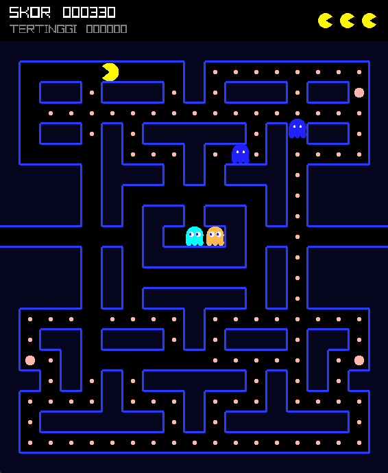

# Pac-Man C++ (raylib)

Game Pac-Man yang dibuat dengan C++ dan library [raylib](https://www.raylib.com/) 5.5. Proyek ini awalnya dibuat sebagai tugas besar mata kuliah algoritma, lalu dikembangkan menjadi game dengan tampilan grafis dan gerakan yang halus.



## Fitur

- 4 hantu dengan 3 mode perilaku: kejar, sebar, dan takut
- Power pellet yang membuat hantu jadi takut dan bisa dimakan
- Lorong tembus kiri-kanan
- Sistem nyawa
- Skor tertinggi (high score)
- Layar menang dan layar kalah (tekan Enter untuk main lagi)
- Gerakan Pac-Man dan hantu yang halus

## Kontrol

| Tombol | Fungsi |
| --- | --- |
| W / Panah Atas | Gerak ke atas |
| A / Panah Kiri | Gerak ke kiri |
| S / Panah Bawah | Gerak ke bawah |
| D / Panah Kanan | Gerak ke kanan |
| Enter | Main lagi (di layar menang atau kalah) |

## Cara Menjalankan (tanpa compile)

1. Buka halaman [Releases](https://github.com/rivanfathur-rgb/pacman-cpp/releases) di repo ini.
2. Unduh file zip pada rilis terbaru.
3. Ekstrak (extract) semua isi zip ke satu folder.
4. Jalankan `game.exe`.

Jangan pindahkan `game.exe` sendirian keluar dari folder tersebut, karena game butuh file DLL di sebelahnya (lihat catatan DLL di bawah).

## Cara Compile

1. Pasang [MSYS2](https://www.msys2.org/).
2. Buka terminal **MSYS2 UCRT64** (bukan terminal MSYS2 biasa).
3. Pasang compiler dan raylib:

   ```bash
   pacman -S mingw-w64-ucrt-x86_64-gcc
   pacman -S mingw-w64-ucrt-x86_64-raylib
   ```

4. Masuk ke folder proyek, lalu compile:

   ```bash
   g++ game.cpp -o game -lraylib -lopengl32 -lgdi32 -lwinmm
   ```

5. Jalankan hasilnya:

   ```bash
   ./game.exe
   ```

## Struktur File

```
pacman-cpp/
├── game.cpp      # Kode sumber game
├── README.md     # Dokumentasi ini
├── LICENSE       # Lisensi proyek
└── .gitignore    # Mengabaikan file hasil compile (.exe, .dll, dll.)
```

File `game.exe` dan DLL tidak disimpan di repo, tetapi tersedia di halaman Releases.

## Catatan soal DLL

Linking statis (`-static`) tidak berhasil di setup saya, jadi game ini memakai DLL. Supaya `game.exe` bisa jalan di komputer tanpa MSYS2, kelima file DLL berikut harus berada di folder yang sama dengan `game.exe`:

- `glfw3.dll`
- `libgcc_s_seh-1.dll`
- `libraylib.dll`
- `libstdc++-6.dll`
- `libwinpthread-1.dll`

Kelimanya sudah disertakan di dalam zip pada halaman Releases.

## Lisensi

Lihat berkas [LICENSE](LICENSE).